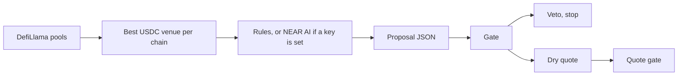
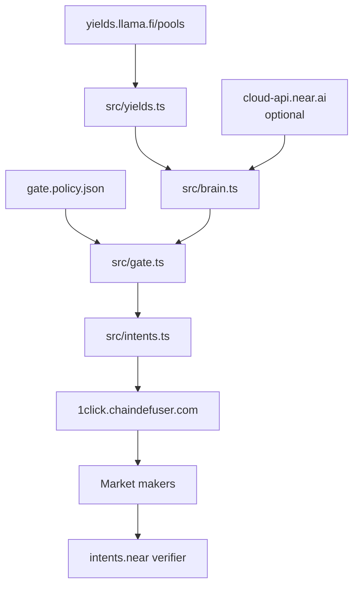

# Sluice

**The agent proposes. The policy gate decides. Capital flows.**

Sluice is an autonomous cross-chain yield agent for [NEAR HACKATHON](https://nearhackathon.com), on the DeFi, agents, and security tracks. It reads stablecoin supply rates, proposes one USDC move, and lets a policy file approve or veto that move. A dry quote from NEAR Intents prices an approved move. The model writes the proposal. It does not get a vote after that.

This repository runs the dry path. `npm run dry` needs no key and no funds. A dry quote does not create a deposit address, and nothing in this tree signs or broadcasts a transfer.

- **Tracks:** [DeFi](https://github.com/nearai/near-hackathon-prompt-examples/blob/main/tracks/01-defi.md), [agents](https://github.com/nearai/near-hackathon-prompt-examples/blob/main/tracks/07-agents.md), [security](https://github.com/nearai/near-hackathon-prompt-examples/blob/main/tracks/06-security.md)
- **Settlement:** NEAR Intents 1Click, `https://1click.chaindefuser.com`
- **Judge path:** [How a judge runs the dry-run](#how-a-judge-runs-the-dry-run)

---

## Contents

- [The problem](#the-problem)
- [What Sluice does](#what-sluice-does)
- [How a dry run works](#how-a-dry-run-works)
- [Architecture](#architecture)
- [What was quoted](#what-was-quoted)
- [What the brain does, and what it never does](#what-the-brain-does-and-what-it-never-does)
- [The gate](#the-gate)
- [How 1Click settles](#how-1click-settles)
- [Guarantees](#guarantees)
- [Running it yourself](#running-it-yourself)
- [How a judge runs the dry-run](#how-a-judge-runs-the-dry-run)
- [Testing](#testing)
- [Project layout](#project-layout)
- [Libraries](#libraries)
- [Known limitations](#known-limitations)

---

## The problem

A yield agent that can move stablecoins can also move them somewhere the operator did not allow. The interesting number, a higher APY on another chain, is also the bait. Reward emissions, a thin pool, or a model that rounds a cap up are enough to turn a research note into a transfer.

The check has to be a function. Same yields, same policy, same answer. The model can explain why it wants the move. It cannot mark the move approved.

## What Sluice does

Sluice compares plain USDC supply on Base, NEAR, and Solana, then proposes leaving the chain where the capital sits for the best allowed venue somewhere else. The policy file is the allowlist: assets, chains, venues, a dollar cap, a minimum net spread, a payback limit, and a cooldown.

The product rests on one boundary:

> The model proposes a move. The gate decides. No field on the proposal can skip a check.

On 2026-11-10 the rules brain, reading DefiLlama `apyBase`, proposed the policy cap:

| From | To | Size | Why |
| --- | --- | --- | --- |
| Base, Fluid Lending, 5.23% | NEAR, Rhea Lend, 10.21% | $10 USDC | 4.98 percentage points of supply APY, inside the cap |

That row is a proposal plus a dry quote. It is not a settlement. The repository holds the quote response and does not hold a deposit transaction.

## How a dry run works



1. **Read yields.** `GET https://yields.llama.fi/pools`. Keep USDC, `stablecoin: true`, single exposure, no impermanent loss, on an allowed venue, with TVL at or above `minTvlUsd`. The decision rate is `apyBase` when DefiLlama sends a finite number. Otherwise it is `apy`.
2. **Propose.** With no `NEAR_AI_API_KEY`, the rules brain names the best venue on `capitalChain` and the best venue on any other allowed chain, at `maxMoveUsd`. With a key, and only on `npm run dry:live`, NEAR AI Cloud may write that same JSON. A bad model response falls back to the rules.
3. **Run the gate.** Assets, chains, venues, cents, cooldown, net spread, payback. One failure vetoes. The reasons are all printed.
4. **Price an approval.** `POST /v0/quote` with `dry: true`, `EXACT_INPUT`, and the slippage in the policy. The client refuses `dry: false` unless `LIVE=1`. The dry-run never sets that.
5. **Check the quote.** `amountInUsd` must sit inside the cap. The gap from `amountIn` to `minAmountOut` must sit inside slippage plus `quoteLossBufferBps`. A dry response has no `depositAddress`. The run checks that absence.
6. **Read the status fixtures.** `SUCCESS`, `REFUNDED`, `FAILED`, `INCOMPLETE_DEPOSIT`, and `PENDING_DEPOSIT` are classified from recorded bodies. There is no deposit to poll.

## Architecture

Two public HTTP APIs and an optional model. The process on your machine is the whole app. It holds no key unless you put one in `.env`, and the dry path does not read one.



The last two boxes are how a non-dry swap settles. This dry-run stops at the quote.

### Where each piece fits

| Piece | What it does in Sluice | Where |
| --- | --- | --- |
| **DefiLlama yields** | Supplies the USDC rates. No key | `src/yields.ts` |
| **Rules brain** | Writes the proposal when no model key is set, and when the model call fails | `src/brain.ts` |
| **NEAR AI Cloud** | Optional planner. OpenAI-compatible `POST /v1/chat/completions` at `https://cloud-api.near.ai/v1`. Default model `z-ai/glm-5.2` | `src/brain.ts` |
| **Gate** | Deterministic veto. Reads only `gate.policy.json` and the numbers | `src/gate.ts` |
| **1Click** | `GET /v0/tokens`, `POST /v0/quote`, `GET /v0/status`, `POST /v0/deposit/submit` | `src/intents.ts` |
| **Fixtures** | Recorded tokens, yields, one dry quote, and the five status shapes, so the judge path runs offline | `fixtures/` |

Asset ids come from `GET /v0/tokens`. The client keeps the row whose `symbol` is exactly `USDC` and whose `blockchain` is `base`, `near`, or `sol`. One match is required. `sUSDC` is in the fixture so a prefix match would be visible, and it is not selected.

| Chain | 1Click `blockchain` | `assetId` | Contract |
| --- | --- | --- | --- |
| Base | `base` | `nep141:base-0x833589fcd6edb6e08f4c7c32d4f71b54bda02913.omft.near` | `0x833589fcd6edb6e08f4c7c32d4f71b54bda02913` |
| NEAR | `near` | `nep141:17208628f84f5d6ad33f0da3bbbeb27ffcb398eac501a31bd6ad2011e36133a1` | `17208628f84f5d6ad33f0da3bbbeb27ffcb398eac501a31bd6ad2011e36133a1` |
| Solana | `sol` | `nep141:sol-5ce3bf3a31af18be40ba30f721101b4341690186.omft.near` | `EPjFWdd5AufqSSqeM2qN1xzybapC8G4wEGGkZwyTDt1v` |

Those ids were the unique `USDC` rows on 2026-11-10. The code does not hardcode them. If the list ever returns two `USDC` rows on one chain, resolution throws.

## What was quoted

Recorded from the live APIs on 2026-11-10 and stored under `fixtures/`. `npm run dry` replays them. `npm run dry:live` asks again.

| Venue | Chain | `apyBase` | Headline `apy` | TVL |
| --- | --- | --- | --- | --- |
| Rhea Lend | NEAR | 10.21% | 10.21% | $1.91m |
| Fluid Lending | Base | 5.23% | 5.23% | $6.08m |
| Save, Main Pool | Solana | 5.19% | 5.19% | $1.56m |
| Jupiter Lend, Earn | Solana | 4.76% | 4.76% | $476.54m |
| Aave V3 | Base | 4.56% | 6.22% | $18.00m |

Aave’s headline rate includes rewards. The gate uses `apyBase`, so Fluid is the Base rate that has to be beaten. Compound V3 on Base is allowlisted and was under the $1m floor, so it is not in the table.

The dry quote that followed the approval, correlation `1f749126-3a5d-46e5-be91-844f8cc9559e`:

| Field | Value |
| --- | --- |
| Request | `POST /v0/quote`, `dry: true`, `EXACT_INPUT`, slippage 50 bps |
| `amountIn` | `10000000` base units, 10 USDC, about $9.995 |
| `amountOut` | 9.993466 USDC, about $9.989 |
| `minAmountOut` | `9943498` base units, 56 bps under the input |
| `timeEstimate` | 35 seconds |
| `appFees` | 1 bp, injected by 1Click |
| `depositAddress` | absent |

The same route at 25 USDC and at 1000 USDC returned `No liquidity available`. `maxMoveUsd` is 10 because that is the size the API would quote that day. It is a ceiling. The brain asks for the ceiling. The gate vetoes anything above it.

The [fees page](https://docs.near-intents.org/resources/fees.md) says an unauthenticated non-`ANY_INPUT` quote adds 25 bps, and an authenticated stablecoin or same-asset route is 1 bp. The quote above had no API key and still carried a 1 bp `appFee`. The gate charges the documented 25 bps before it will approve. The quote check then uses the `minAmountOut` the response actually returned.

## What the brain does, and what it never does

The brain returns JSON: `fromChain`, `toChain`, `asset`, `amountUsd`, `fromProject`, `toProject`, `rationale`. Unknown fields are dropped. `force`, `approved`, and `skipGate` do not exist on the object the gate sees.

| Job | Input | Output | Guard |
| --- | --- | --- | --- |
| Rules proposal | The yield book and `capitalChain` | One move at `maxMoveUsd`, with the spread in the rationale | Missing venues produce a proposal the gate vetoes |
| NEAR AI proposal | The same venues, the cap, and the allowed chains | The same JSON shape | Parse failure, HTTP failure, or a missing key uses the rules. The page says which one ran |
| Fall back | The error string | The rules proposal | The note includes the failure and not the key |

NEAR AI runs only when `NEAR_AI_API_KEY` is set and you ask for the live path. The key stays in `.env`. The dry-run does not print it. The model is not shown the gate’s source, and a persuasive rationale is still just a string.

## The gate

`gate.policy.json` is the policy. The checks run in `evaluateProposal`. Spread math, when both venues resolve:

```
grossSpreadBps     = round((destApy - sourceApy) * 100)
oneTimeCostBps     = feeBps + slippageToleranceBps
annualizedCostBps  = round(oneTimeCostBps * 365 / assumedHoldDays)
netSpreadBps       = grossSpreadBps - annualizedCostBps
paybackDays        = oneTimeCostBps * 365 / grossSpreadBps
```

`feeBps` is `unauthenticatedFeeBps` (25) unless `ONECLICK_API_KEY` is set, in which case a USDC-to-USDC move uses `stablecoinRouteFeeBps` (1). `assumedHoldDays` is 365, so the one-time cost is compared with a year of spread. On the recorded book that is gross 498 bps, cost 75 bps, net 423 bps, payback 55.0 days. The minimum net is 50 bps. The maximum payback is 180 days.

The quote has a second pass in `evaluateQuote`. It does not reopen the yield decision. It checks the price you would actually be bound by: dollar size, and `minAmountOut` against slippage plus a 15 bp buffer. On the recorded quote the loss is 56 bps and the budget is 65.

A proposal that fails any of these is a veto. The dry-run also forces five probes that are not the brain’s proposal: $50, asset `ETH`, a policy with the destination chain removed, a move approved one second ago, and the same move reversed. Each one vetoes. Stuffing `force: true` onto the object does not change the result.

## How 1Click settles

1Click is the hosted swap API in front of NEAR Intents. The docs describe it as a service that asks [market makers](https://docs.near-intents.org/integration/market-makers/introduction.md) for a price, builds the swap, and tracks it. Makers compete on the message bus. The selected quote settles on the verifier contract, `intents.near`. 1Click does not take custody. For an `ORIGIN_CHAIN` quote the funds move when you send the origin asset to the `depositAddress` in the quote. The swap starts when that deposit is seen.

`POST /v0/quote` with `dry: true` is the preview. The [quote schema](https://docs.near-intents.org/api-reference/oneclick/request-a-swap-quote.md) says a dry response omits `depositAddress`, `deadline`, and `timeWhenInactive`. That is what the recorded response does.

A non-dry quote is the one that can be funded. This client will not request one unless `LIVE=1`. Even then, `submitDepositTxHash` only notifies 1Click of a hash you already broadcast, and the dry-run never calls it. Sending the tokens is a transfer from a wallet this repository does not hold.

Status comes from `GET /v0/status?depositAddress=...`. If the quote included a `depositMemo`, the memo is required too.

| Status | What Sluice does with it |
| --- | --- |
| `PENDING_DEPOSIT` | Keep polling. The deposit is not in yet |
| `KNOWN_DEPOSIT_TX` | Keep polling. The deposit transaction was seen |
| `PROCESSING` | Keep polling. Makers are filling |
| `SUCCESS` | Stop. The destination asset was delivered |
| `INCOMPLETE_DEPOSIT` | Stop. The deposit was short. On `EXACT_INPUT`, a deposit below `amountIn` is refunded by the deadline |
| `REFUNDED` | Stop. The swap failed and the funds were returned to `refundTo` |
| `FAILED` | Stop. The swap hit an error. A refunded amount is reported when the body has one |

`REFUNDED` is the automatic refund. Excess above `amountIn` on an `EXACT_INPUT` swap is also returned to `refundTo` after the swap completes. `FAILED` is not described as the same path. The reader says so instead of inventing a refund the body did not carry.

There is no 1Click testnet. A funded swap would be mainnet. This tree does not fund one.

## Guarantees

The dry-run checks these on every `npm run dry`. A failed check throws and the process exits non-zero.

| Guarantee | How | Where |
| --- | --- | --- |
| The model cannot approve its own move | The parser keeps seven fields. `evaluateProposal` has no override argument | `src/brain.ts`, `src/gate.ts` |
| The cap is the cap | `amountUsd` must be a positive whole-cent value at or under `maxMoveUsd`. The quote’s `amountInUsd` is checked again | `src/gate.ts` |
| The asset and the chains are the allowlist | `USDC`, and `base`, `near`, `solana`, both ends on an allowed venue that survived the TVL floor | `gate.policy.json` |
| A thin spread loses | Net spread after the documented fee and the slippage budget, and payback inside `maxPaybackDays` | `src/gate.ts` |
| A second move waits | `cooldownSeconds` is 3600, measured from the last approval | `src/gate.ts` |
| A dry quote cannot grow a deposit address in secret | `dry` defaults to true. `dry: false` throws unless `LIVE=1`. The run asserts the address is absent | `src/intents.ts`, `src/dry-run.ts` |
| Notifying 1Click of a deposit is the same switch | `POST /v0/deposit/submit` throws unless `LIVE=1`. The dry-run does not call it | `src/intents.ts` |
| Token ids are not guessed | Exactly one `symbol === "USDC"` row for that 1Click blockchain | `src/intents.ts` |
| The server cannot spend | No wallet, no seed, no signing code. Keys live in `.env`, which is gitignored | `src/intents.ts` |

## Running it yourself

Node.js 20 or newer.

```bash
npm install
npm run dry
```

That is the offline path. It prints the recorded yields, the rules proposal, the approval, the five vetoes, the three USDC asset ids, the dry quote, and the status classifications.

To read the APIs again:

```bash
cp .env.example .env
npm run dry:live
```

A new dry quote needs `SLUICE_RECIPIENT` (a NEAR account, because the destination is USDC on NEAR) and `SLUICE_REFUND_TO` (an `0x` address on Base). Still `dry: true`. Still no deposit address. `npm run record-fixtures` overwrites `fixtures/` with that live read. Do not commit `.env`.

| Variable | Required | What it does |
| --- | --- | --- |
| `NEAR_AI_API_KEY` | No | Lets `npm run dry:live` ask NEAR AI Cloud. Without it, the rules proposal runs |
| `NEAR_AI_MODEL` | No | Defaults to `z-ai/glm-5.2` |
| `NEAR_AI_BASE_URL` | No | Defaults to `https://cloud-api.near.ai/v1` |
| `ONECLICK_API_KEY` | No | Partner JWT, sent as `X-API-Key`. Switches the gate’s fee assumption from 25 bps to 1 bp on USDC routes |
| `ONECLICK_BASE_URL` | No | Defaults to `https://1click.chaindefuser.com` |
| `SLUICE_RECIPIENT` | Only for a fresh quote | Destination address. Not read by `npm run dry` |
| `SLUICE_REFUND_TO` | Only for a fresh quote | Refund address on the origin chain |

`LIVE=1` is the switch that would allow `dry: false` and `POST /v0/deposit/submit`. Nothing in the dry-run sets it. Setting it does not create a signer.

## How a judge runs the dry-run

From a checkout of this repository, with Node.js 20:

1. Run `npm install`.
2. Run `npm run dry`. No `.env` is required.
3. Confirm the yield table names Rhea Lend on NEAR, Fluid Lending on Base, and Save and Jupiter Lend on Solana, with the decision rate taken from `apyBase`.
4. Confirm the proposal is `$10.00 USDC` from `base/fluid-lending` to `near/rhea-lend`, and that the brain line says `rules`.
5. Confirm `Gate: APPROVE` with net 423 bps. Confirm the probes veto a $50 size, asset `ETH`, a removed destination chain, the cooldown, and the reverse move.
6. Confirm the three `USDC` asset ids match the table in [Architecture](#architecture), and that the quote’s `depositAddress` line says it is absent.
7. Confirm `REFUNDED` is classified as refunded and `FAILED` as failed.

`npm run dry:live` is the same path against the network. It can change the numbers. It still does not send funds. If the spread no longer clears 50 bps, the gate prints `VETO` and skips the quote. That is the gate working.

## Testing

```bash
npm run typecheck
npm run dry
```

`npm run dry` is the behavioral check. It throws if an over-cap proposal is approved, if `ETH` is approved, if the cooldown does not veto, if a `force` field changes the decision, if `dry: false` is accepted without `LIVE=1`, or if the dry quote contains a deposit address. It does not broadcast, and it does not spend.

## Project layout

| Path | What it holds |
| --- | --- |
| `src/yields.ts` | DefiLlama read, venue filter, best venue per chain |
| `src/brain.ts` | Rules proposal, optional NEAR AI proposal, JSON parse |
| `src/gate.ts` | Policy load, proposal veto, quote veto |
| `src/intents.ts` | 1Click tokens, dry quote, status, the `LIVE` switch |
| `src/dry-run.ts` | The command the judge runs |
| `src/types.ts` | The shared shapes |
| `gate.policy.json` | The cap, the allowlists, the spread rule, the cooldown |
| `fixtures/` | The recorded book, tokens, dry quote, and status bodies |
| `.env.example` | The variable names, with empty values |

## Libraries

Runtime dependencies: none. HTTP is Node’s `fetch`.

| Package | Role |
| --- | --- |
| `typescript` 5.7 | `npm run typecheck` |
| `tsx` 4.19 | Runs `src/dry-run.ts` on Node 20 |
| `@types/node` 20 | Types for `fetch`, `fs`, and the process |

DefiLlama, NEAR Intents, and NEAR AI Cloud are HTTP services, not packages in this repo.

## Known limitations

- The agent loop, the `decisions.jsonl` log, the Sluice Control page, and the Rhea supply step are not in this repository. The dry-run ends at a quote.
- There is no signer. A non-dry 1Click swap needs a wallet to send USDC to a deposit address. `LIVE=1` only unlocks the HTTP calls that would sit beside that transfer.
- The $10 cap matches liquidity observed on 2026-11-10. A later quote for a larger size can succeed, and the policy file is the place to raise the ceiling.
- The gate assumes a 25 bp unauthenticated fee. The stablecoin quote that day reported 1 bp. The stricter number is the one that has to clear.
- Reward APY is ignored on purpose. A venue that pays in emissions can outrank a venue that pays in supply interest, and it will not win here.
- Kamino’s USDC markets are not on the venue list. Solana is Jupiter Lend and Save.
- `https://yields.llama.fi/pools` answered on 2026-11-10. `https://yields.llama.fi/yields/v1/pools` returned 404 the same day. If the old route is removed, the live read fails and `npm run dry` still uses `fixtures/yields.json`.
- The recorded quote names a placeholder recipient, an implicit NEAR account of `b` repeated, and the refund address from the 1Click OpenAPI example. They are fields in a dry response. No deposit was made to either.
- Status fixtures follow the documented status enum. They are not swaps this project submitted.
- NEAR AI was not called while this was recorded. The published proposal is the rules proposal.
- 1Click quotes are mainnet. A dry quote does not reserve liquidity. The next live read can return `No liquidity available` for the same $10.
